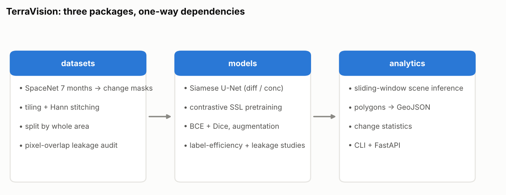
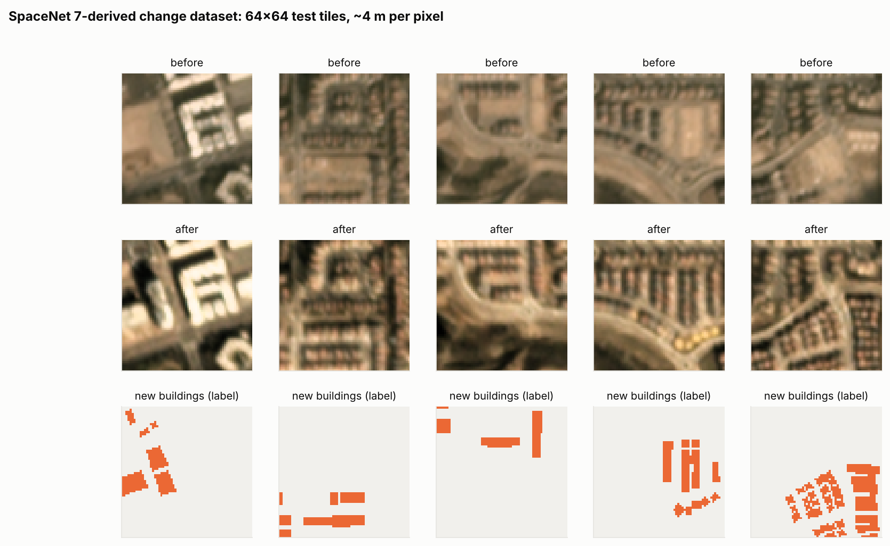
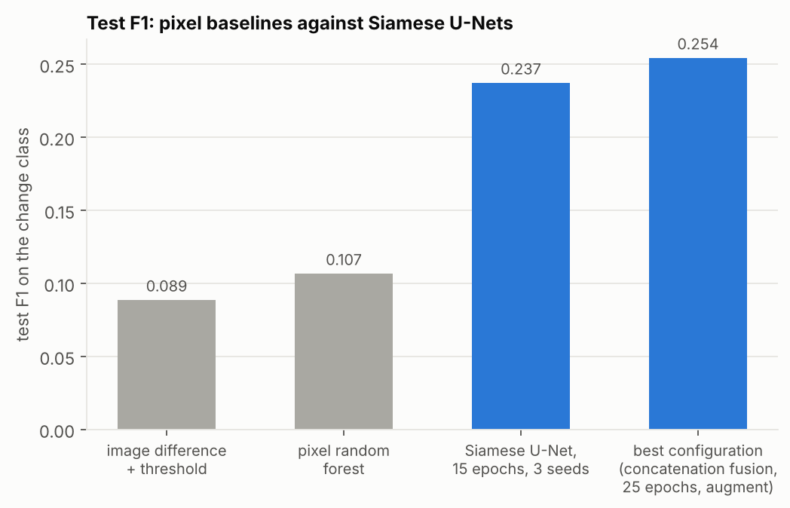
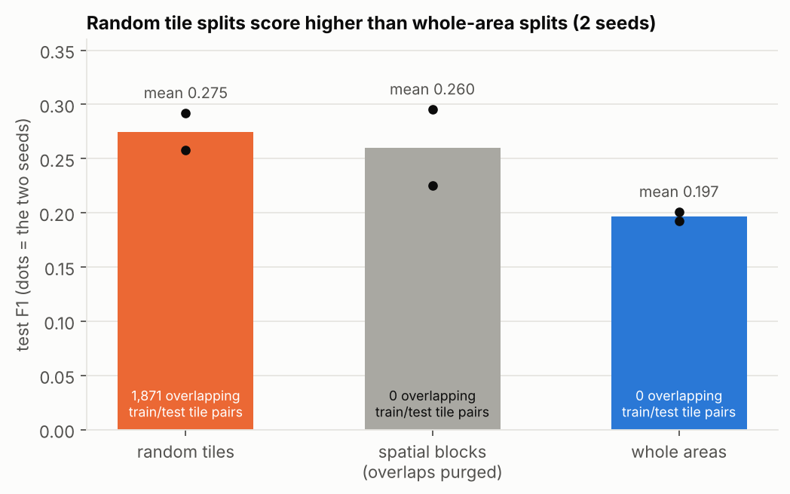
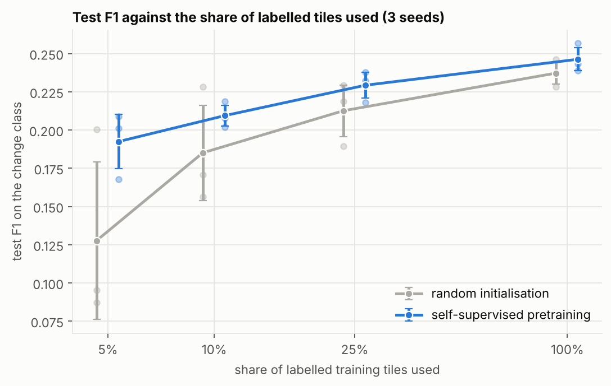
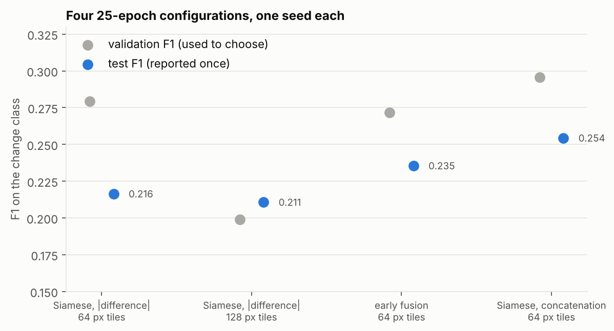
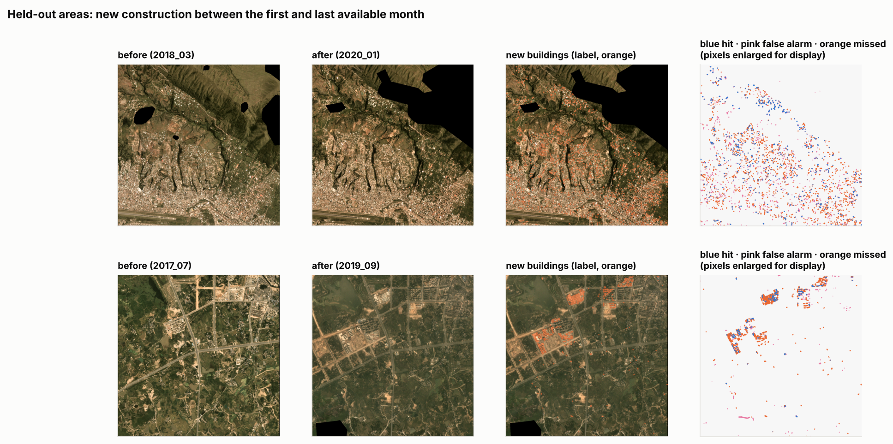

# TerraVision

Bi-temporal **satellite change detection** with a focus on evaluation honesty and label
efficiency.

Three independently installable packages with one-way dependencies:

```
terravision-datasets  ──▶  terravision-models  ──▶  terravision-analytics
 tiling, stitching,         U-Nets (early fusion,        scene inference, GeoJSON
 blocked splits + audit     Siamese), SSL pretraining,   polygons, statistics, API
 (numpy, scipy)             label-efficiency study (torch)
```

| Package | Responsibility |
|---|---|
| [`terravision-datasets`](terravision-datasets) | tiling / Hann-blended stitching, spatially blocked splits, overlap purge, geometric leakage audit, checksummed tile format, synthetic scenes for tests |
| [`terravision-models`](terravision-models) | `fc-ef` / `fc-siam-conc` / `fc-siam-diff` U-Nets, NT-Xent and contrastive pretraining (augmentation or temporal positives), BCE+Dice training, baselines, experiments |
| [`terravision-analytics`](terravision-analytics) | checkpoints, whole-scene inference, polygon extraction, change statistics, CLI and HTTP API |



## Research questions

1. **Label efficiency.** With 5–100% of the labelled tiles, does self-supervised pretraining
   on the unlabelled before/after tiles improve change F1/IoU over random initialisation?
2. **Evaluation leakage.** How much does a random tile split (overlapping tiles on both
   sides of the boundary) inflate test scores compared with a spatially blocked, purged split?

## Status (honest summary)

| Item | State |
|---|---|
| All three packages implemented and unit-tested on synthetic scenes | yes (shapes, gradients, symmetric fusion, NT-Xent, SSL loss decrease, leakage detection, tile/stitch exactness, GeoJSON georeferencing, API validation) |
| Experiments on real satellite imagery | **run on a SpaceNet 7-derived new-construction task** (CPU, 3 seeds, 30 areas): baselines, split leakage, label efficiency, configuration comparison; OSCD, LEVIR-CD and Sentinel-2 change datasets were unreachable |
| Readers for real data | SpaceNet 7 reader/builder written and tested; OSCD / LEVIR-CD readers **not written** |
| GPU / CUDA / mixed-precision code paths | written, **never executed** (the development container has no GPU); CPU paths are what the tests cover |
| Published numbers | none; see Results above for the measured values and their limits |

The next steps are to run the same pipeline on a standard benchmark such as OSCD (check its
license; a reader must be written against the real files) and to run longer pretraining and
more seeds on a GPU.

## Results on real satellite imagery (CPU)

### The dataset

Derived from SpaceNet 7 (monthly Planet mosaics, about 4 m per pixel; building footprints
with persistent ids; CC BY-SA 4.0, verify at spacenet.ai): the task is **new construction**.
A pixel is "changed" if it lies in a building footprint present in a later month whose id is
absent in the earlier month. The labels are derived here (they are not an official
change-detection benchmark) and annotation gaps and clouds add label noise. 30 randomly
chosen areas × first / middle / last month give two ~12-month date pairs each; 64 × 64 tiles
with at least 90% valid pixels in both dates: **14,918 tiles**, split **by area**
(18 / 6 / 6 areas → 8,941 / 3,004 / 2,973 tiles). Only 0.53% of pixels are changed; 24.7% of
training tiles contain any change. Build it with
`terravision-data spacenet --cache <dir> --out <dir> --aois 30 --tile 64`.



### Non-deep baselines (test split, change class)

| method | precision | recall | F1 | IoU | kappa |
|---|---|---|---|---|---|
| thresholded image difference | 0.072 | 0.115 | 0.089 | 0.046 | 0.083 |
| pixel random forest | 0.082 | 0.152 | 0.107 | 0.056 | 0.101 |

Simple methods fail because seasonal and illumination differences between months dwarf the
signal of new buildings.



### How much does a leaky split inflate the score? (same model, same data)

`fc-siam-diff`, 8 epochs, empty tiles kept at 1× the number of tiles with change, validation
threshold, **two seeds** (each strategy has a different test set, so the numbers are not
paired). "Overlapping pairs" = train/test tile pairs sharing pixels (the audit):

| split strategy | seed 0 F1 / IoU | seed 1 F1 / IoU | train/test tile pairs overlapping |
|---|---|---|---|
| random tiles | 0.258 / 0.148 | 0.292 / 0.171 | 1,857 / 1,886 |
| spatial blocks (overlaps purged) | 0.225 / 0.127 | 0.295 / 0.173 | 0 / 0 |
| whole areas (scenes) | **0.192 / 0.106** | **0.201 / 0.112** | 0 / 0 |



Random tile splits put the same location (other date pair, adjacent tiles) on both sides; the
strict whole-area split scores lower in both seeds (F1 0.19–0.20 vs 0.26–0.29, a relative
inflation of about 34–45%). Blocked splits sit in between and are noisy (equal to the random
split in seed 1). With only two seeds, treat the size of the gap as indicative. Raw values:
[`terravision-models/results/spacenet/leakage.json`](terravision-models/results/spacenet/leakage.json).

### Does self-supervised pretraining help with few labels?

Concatenation-fusion Siamese U-Net (`fc-siam-conc`), 15 epochs with augmentation and a cosine
schedule, checkpoints chosen by best-threshold validation F1, **3 seeds**; test F1 on the change
class, mean ± std. "SSL" = contrastive pretraining (10 epochs, temporal positives: the same
tile at both dates, plus augmentation) on the *unlabelled* training tiles, then supervised
fine-tuning. "Label fraction" is the share of the 8,941 training tiles whose labels are used;
empty tiles are then thinned to as many as there are tiles with change (identically for both
arms), so the tiles actually trained on were about 210–260, 440–480, 1,100–1,230 and 4,420.

| label fraction | random init F1 | SSL init F1 | SSL − random (paired by seed) | seeds where SSL is better |
|---|---|---|---|---|
| 5% | 0.128 ± 0.051 | 0.192 ± 0.018 | +0.065 (per seed: +0.122, +0.072, +0.001) | 3 / 3 |
| 10% | 0.185 ± 0.031 | 0.209 ± 0.007 | +0.024 | 2 / 3 |
| 25% | 0.213 ± 0.017 | 0.229 ± 0.008 | +0.017 | 2 / 3 |
| 100% | 0.237 ± 0.007 | 0.246 ± 0.008 | +0.009 | 2 / 3 |



What this supports: more labels help clearly (F1 0.13 → 0.24 without pretraining), and the
mean advantage of SSL initialisation is positive at every fraction and shrinks as labels grow
(+0.065 at 5% → +0.009 at 100%), the pattern one expects from pretraining. SSL runs also vary
much less between seeds at low label fractions. **But with three seeds this is suggestive, not
established**: at 10%, 25% and 100% one seed in three shows no gain, and the 5% gain rests on
two seeds with a large effect and one with none. The contrastive loss fell from 3.1 to about 1.8,
so the pretraining ran as intended; 10 epochs on 8.9k tiles is short.

An earlier run of this study (3-epoch-shorter training, |difference| fusion, checkpoints chosen
by F1 at a fixed 0.5 threshold, which is nearly meaningless with 0.5% positive pixels) found
gains of only +0.009 to +0.015 at low fractions and −0.002 at 100%, all inside the seed spread
([`label_efficiency_v1_f1at05_selection.json`](terravision-models/results/spacenet/label_efficiency_v1_f1at05_selection.json)).
The corrected protocol is the one reported above.

Other limits: 64 px tiles, CPU only, labels derived from building footprints (noisy), 30 areas.
Raw values:
[`terravision-models/results/spacenet/label_efficiency.json`](terravision-models/results/spacenet/label_efficiency.json).
Commands: [`terravision-models/results/spacenet/run.sh`](terravision-models/results/spacenet/run.sh).

### Improving the model: what helped and what did not

After the studies above I trained longer (25 epochs), added flip/rotation augmentation and a
cosine learning-rate schedule, and compared fusion designs and tile sizes. One seed each; the
checkpoint of each run is the epoch with the best validation F1 (best threshold); the test set is
evaluated once. Results in
[`terravision-models/results/spacenet/config_*.json`](terravision-models/results/spacenet):

| configuration | validation F1 | test F1 | test IoU | precision | recall |
|---|---|---|---|---|---|
| Siamese, \|difference\| skips, 64 px | 0.279 | 0.216 | 0.121 | 0.191 | 0.249 |
| Siamese, \|difference\| skips, 128 px tiles | 0.199* | 0.211 | 0.118 | 0.189 | 0.238 |
| early fusion (before ‖ after as one input), 64 px | 0.272 | 0.235 | 0.133 | 0.245 | 0.226 |
| **Siamese, concatenated skips, 64 px** | **0.296** | **0.254** | **0.146** | 0.248 | 0.261 |

\* validated on 300 128-px tiles, a different subset, so not directly comparable. The earlier
10-epoch |difference| model scored 0.227 ± 0.015 (three seeds), and the three-seed spread
means differences of about 0.02 F1 are within noise.



- The configuration with the best *validation* F1 (concatenated skips) also has the best test F1
  (0.254, IoU 0.146); it is the saved model
  [`results/spacenet/best_model.pt`](terravision-models/results/spacenet/best_model.pt). Its
  advantage over the earlier model (+0.03 F1) is about two seed standard deviations: suggestive,
  not conclusive.
- **Longer training, augmentation and larger context did not help by themselves** (the
  |difference| model stayed at 0.21–0.23 with either 64 or 128 px tiles). The limit appears to
  be the noisy derived labels and the differences between areas, not optimisation.
- The held-out areas below show what an F1 of 0.25 looks like: the model finds a number of
  real construction sites (blue) but misses many small buildings (orange), especially in the
  dense hillside scene, and raises some false alarms (pink).



**Two methodological problems found along the way (both fixed):**
(1) Checkpoint selection originally used F1 at a fixed 0.5 threshold, which is nearly
meaningless with 0.5% positive pixels. The training loop now selects by best-threshold
validation F1; the label-efficiency study and the configuration comparison were rerun/run with
it (the first label-efficiency run is kept for transparency). The split-leakage experiment above
still uses the old selection and would be worth repeating with it; its comparison is
like-for-like across split strategies, but all three scores are likely a little low.
(2) A bug in my `train` command misaligned the validation images and masks, so early stopping
ran on garbage in two discarded runs; test scores were unaffected because they use the full
aligned validation set. A regression test now covers it.

## Quick start

```bash
git clone https://github.com/saaki05/project-4 && cd project-4
pip install -e terravision-datasets -e terravision-models -e terravision-analytics
terravision-data synth --out data/synth                      # synthetic, smoke test only
terravision-models label-efficiency --data data/synth --out results/le.json --seeds 0
```

## Regenerating the figures

Every figure in `docs/figures/` is produced from the result files by a script (no number is
typed by hand). `pip install matplotlib`, then:

```bash
python scripts/make_figures.py --tiles data/sn7 --cache cache/   # best_model.pt is used for the overlay
```

## License

MIT. Satellite datasets carry their own licenses.
