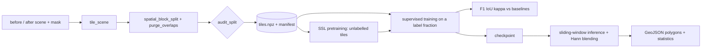

# TerraVision: methodology and paper outline

## Architecture

## Models

`fc-ef` (early fusion), `fc-siam-conc` and `fc-siam-diff` (shared encoder; concatenated or
absolute-difference skips), all U-Net based, with BCE + soft-Dice loss. Baselines: thresholded
magnitude of the spectral difference and a pixel-wise random forest.

## Self-supervised pretraining

NT-Xent contrastive loss on the shared single-date encoder, with positives formed either from
two augmentations of one tile, or from the same tile at the two dates (unchanged content
dominates, plus augmentation). No change labels are used.

## Experiments

1. Label efficiency: random vs. SSL-initialised encoders at label fractions (5%, 10%, 25%,
   100%), several seeds, same validation-threshold protocol, same architecture.
2. Split leakage: identical model and training under a random tile split vs. a spatially
   blocked and purged split, with the geometric audit reported for both.

## Metrics

Precision, recall, F1/Dice, IoU on the change class, Cohen's kappa. The decision threshold is
chosen on validation tiles only.

## Threats to validity

- OSCD has few scenes; variance across splits will be large and must be reported.
- Class imbalance makes accuracy meaningless; only change-class metrics are used.
- SSL benefits depend on the amount of unlabelled data, which is small here.
- Synthetic scenes (used for tests) are far easier than real imagery.

## Paper outline (fill only from real-data results)

1. Introduction: label scarcity and optimistic evaluation in change detection.
2. Related work: Siamese FCNs, SSL for remote sensing, evaluation pitfalls.
3. Method and protocol.
4. Results: baselines, label-efficiency curves, leakage inflation.
5. Limitations and conclusion.
